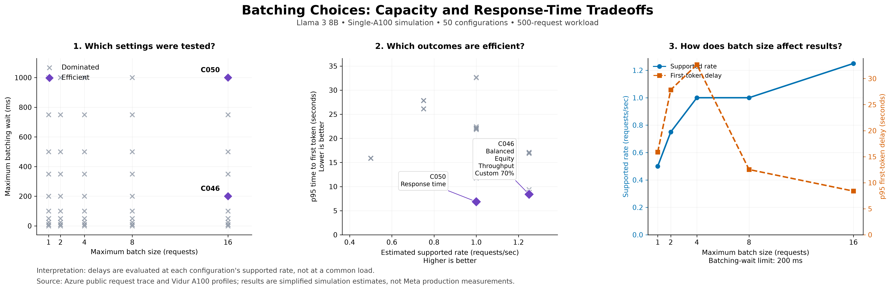
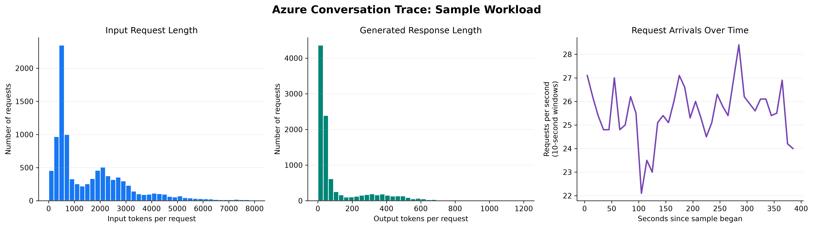

# Balancing AI Request Throughput and Response Time at Meta

**Author:** Isabelle Jean  
**Project:** Final Project Phase 1 — Optimization Engine

## Project Overview

I explore how batching settings affect processing capacity and response
time for a representative Llama 3 8B inference service on one A100 GPU.

The business question is: which batching configurations can support
more requests while keeping the delay before a response begins lower?

This project uses public workload data and measured performance profiles
to inform a simplified simulation. The results are estimates, not
measurements of Meta's production systems.

## Decision Variables and Objectives

| Type | Variable | Meaning |
|---|---|---|
| Decision | Maximum batch size | Maximum requests grouped in a batch |
| Decision | Maximum batching wait | Intentional delay allowed to collect requests |
| Objective | Maximize estimated supported rate | Requests per second that pass the capacity screen |
| Objective | Minimize p95 time to first token | First-response delay for the 95th-percentile request |

The analysis evaluates 50 configurations:

- Maximum batch sizes: 1, 2, 4, 8, and 16 requests.
- Maximum batching waits: 0, 10, 25, 50, 100, 200, 350, 500, 750,
  and 1,000 milliseconds.

## Data Sources
See [Data Sources and Preparation](DATA_SOURCES.md) for source versions,
validation results, and transformations.

### Azure LLM Inference Trace

Source: [Azure LLM Inference Dataset 2024](https://github.com/Azure/AzurePublicDataset/blob/master/AzureLLMInferenceDataset2024.md)

I downloaded the first 10,000 records from the conversation trace.
The fields contain request timestamps, input token counts, and generated
token counts.

The sample covers approximately 392 seconds. Validation found no missing
values, exact duplicate records, or zero token counts. I also examined
token distributions and request arrivals over time.

The configuration analysis uses the first 500 requests from the validated,
chronologically sorted sample. Arrival spacing is rescaled for load tests;
request order and token counts remain unchanged.

### Vidur Performance Profiles

Source: [Microsoft Vidur](https://github.com/microsoft/vidur)

Profile version: `abae7f63aa857300f5cdc6f5e0d27860cd24721b`

Profile directory:
`data/profiling/compute/a100/meta-llama/Meta-Llama-3-8B/`

I use the published MLP and attention timing profiles, selecting one
tensor-parallel worker and the FlashInfer attention backend.

Both downloaded profiles passed missing-value and nonnegative timing
checks. I removed 63 exact duplicate rows from the attention working
copy before selecting the single-GPU profiles. Original downloads
remain unchanged.

The final configuration dataset is simulation-derived from these public
inputs. It was not obtained from Meta or generated as an LLM-written
dataset.

## Technical Approach

1. Validate and explore the public request sample.
2. Prepare single-GPU processing-time lookup tables.
3. Estimate transformer processing times using 32 layers and linear
   interpolation between measured settings.
4. Simulate requests in arrival order using static batches.
5. Test nine arrival rates for each of the 50 configurations.
6. Identify dominated and efficient configurations.
7. Compare five strategic priorities and visualize the tradeoffs.

### Capacity Estimation

The tested arrival rates are 0.10, 0.25, 0.50, 0.75, 1.00, 1.25,
1.50, 2.00, and 3.00 requests per second.

A tested rate passes the capacity screen when:

- Observed completed throughput is at least 98% of the offered rate.
- The increase in average waiting time between the first and last
  quarters of requests is no more than 1% of the arrival period.

The highest tested rate that passes becomes the estimated supported
rate. These thresholds are modeling choices, not a proof of long-term
stability.

Each configuration's p95 response delay is measured at its own
estimated supported rate. These are not common-load latency comparisons.

### Pareto Calculation

A configuration is dominated if another supports at least the same
arrival rate with no greater first-token delay, and improves at least
one objective.

The function handles maximization and minimization directions and retains
identical objective pairs. Its time complexity is O(n² × m), where n
is the number of configurations and m is the number of objectives.

Checks cover mixed objective directions, duplicate objective values,
empty input, and a single configuration.

### Strategic Analysis

Throughput and responsiveness are normalized to scores from 0 to 1
using the ranges across all 50 configurations. Higher scores are better.

The five strategies are:

- **Balanced:** Maximize the sum of both normalized scores.
- **Equity:** Minimize the gap between the scores.
- **Throughput priority:** Maximize estimated supported arrival rate.
- **Response-time priority:** Minimize p95 first-token delay.
- **Custom weighted:** Give responsiveness 70% weight and throughput 30%.

Equity refers to balance between normalized objectives, not fairness
between users. The custom weights are an analytical preference, not
a confirmed Meta policy.

## Key Findings

The analysis identified **2 efficient configurations and 48 dominated
configurations**.

| Configuration | Maximum batch size | Batching-wait limit | Estimated supported rate | p95 first-token delay |
|---|---:|---:|---:|---:|
| C046 | 16 | 200 ms | 1.25 requests/sec | 8.393 sec |
| C050 | 16 | 1,000 ms | 1.00 request/sec | 6.856 sec |

Balanced, equity, throughput-priority, and custom weighted strategies
select C046. Response-time priority selects C050.

C046 supports 25% more requests per second than C050, with a p95
first-token delay approximately 1.538 seconds longer at their respective
supported rates.

One dominated-point example is C026 versus C050. Both support an estimated
1 request per second, but C050 reduces p95 first-token delay from
32.678 to 6.856 seconds, approximately a 79% reduction.

These findings identify options for further evaluation. They do not
establish whether either delay meets a real service's requirements.

## Visualizations

### Optimization Tradeoffs



The panels show:

1. Decision space: maximum batch size and batching wait.
2. Objective space: estimated supported rate and p95 first-token delay,
   with efficient configurations and strategy selections highlighted.
3. Batch-size relationships with the batching-wait limit held at 200 ms.

### Workload Exploration



## Repository Contents

| Location | Contents |
|---|---|
| `optimization_engine.ipynb` | Implementation, validation, analysis, and findings |
| `data/` | Public input samples, selected profiles, lookup tables, and results |
| `images/` | Saved workload and optimization visualizations |
| `requirements.txt` | Python dependencies |
| `README.md` | Project overview and reproduction instructions |

Key generated tables include:

- `data/configuration_results.csv`
- `data/capacity_load_tests.csv`
- `data/pareto_frontier.csv`
- `data/strategic_comparison.csv`
- `data/dominated_comparisons.csv`
- `data/ranked_dominance_comparison.csv`

## How to Run

Use Python 3.12 with VS Code's Python and Jupyter extensions.

1. Clone the repository:

   ```bash
   git clone https://github.com/mjeamnarie11-arch/meta-inference-optimization.git
   cd meta-inference-optimization
   ```

2. Install the dependencies:

   ```bash
   python -m pip install -r requirements.txt
   ```

3. Open the repository folder in VS Code.
4. Open `optimization_engine.ipynb`.
5. Select the Python environment containing the installed dependencies.
6. Restart the kernel and run all cells in order.

Run the notebook from the repository folder because paths are based
on the current working directory.

The download cells reuse existing local input files. Internet access
is needed if those files are missing. The simulation runs on the CPU;
an A100 GPU and model weights are not required.

The configuration sweep performs 450 simulations and can take several
minutes. It prints progress and saves result checkpoints after each
configuration. Rerunning the sweep starts it again from the beginning.

## Limitations

- Azure requests may not represent Meta's workload.
- The analysis uses a short, contiguous 500-request subset.
- Static batching and separate prefill processing simplify real scheduling.
- Timing interpolation and average decode context introduce approximation.
- Very short contexts use the minimum measured attention timing.
- Network, CPU scheduling, embedding, and final output-layer costs are excluded.
- GPU memory feasibility has not been enforced.
- Capacity estimates depend on the tested rates and screening thresholds.
- Response delays are evaluated at different supported loads.
- Strategy selections depend on normalization and objective weights.
- Both efficient options use the largest tested batch size, so the search
  does not establish that 16 is the best possible limit.
- Results have not been validated against a deployed inference service.

## Project Scope

Phase 1 implements the optimization engine, Pareto analysis, strategic
comparison, and visualizations. Constraint-aware agent logic is not
implemented in this submission.